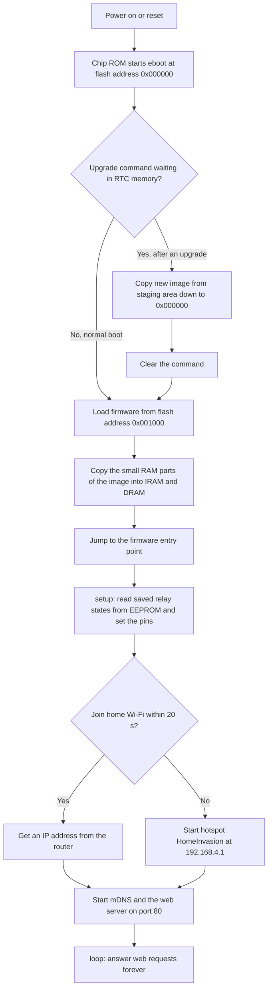
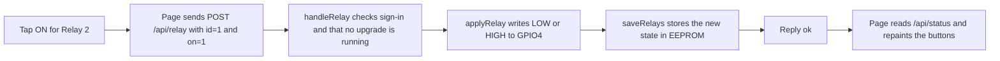
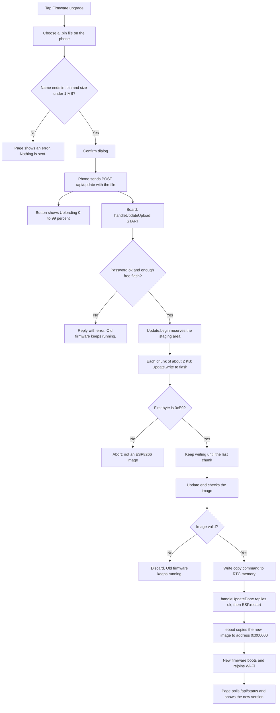

# HomeInvasion

NodeMCU (ESP8266) hosts a phone page on your Wi-Fi. The page switches four relays and can install a new firmware image (a `.bin` file) without the USB cable.

The first install still uses USB. After that, the board already contains the upgrade page, so the next image can be uploaded from the browser. When you tap **Firmware upgrade**, the file is written straight into unused flash next to the running program. It is never saved as a normal file.

To learn how it works inside the chip (boot, relay requests, the upgrade, and the memory map), read [How it works inside the NodeMCU](#how-it-works-inside-the-nodemcu). The setup steps come first.

## Wire the relays

Use a 4-channel relay module. Test with the little LEDs on the module before you connect a load.

| Relay | NodeMCU pin | GPIO | Relay module |
| --- | --- | --- | --- |
| 1 | D1 | 5 | IN1 |
| 2 | D2 | 4 | IN2 |
| 3 | D5 | 14 | IN3 |
| 4 | D6 | 12 | IN4 |
| | VIN or VU (5 V) | | VCC |
| | GND | | GND |

Do not use D3, D4, or D8. Those pins decide how the chip boots.

Most of these modules turn the relay **on** when the input pin is low. That is the default (`RELAY_ACTIVE_LOW 1` in `config.h`). If the page says ON and the module LED is off, set that value to `0` and upload again.

If the NodeMCU resets when several relays click, power the relay board from a separate 5 V supply and join the grounds. The NodeMCU only drives the IN pins.

Household mains on the screw terminals is dangerous. Follow the relay module's own load wiring, keep it enclosed, and stay with the module LEDs until the buttons match.

You can rename the four buttons in `config.h` (`RELAY_NAMES`). Use plain names, with no quote marks.

## 1. Set the Wi-Fi

Open `config.h` and set:

```cpp
#define WIFI_SSID "YOUR_WIFI_NAME"
#define WIFI_PASSWORD "YOUR_WIFI_PASSWORD"
```

The name and password are case-sensitive. The NodeMCU can only join **2.4 GHz**. A normal dual-band home network is fine. Guest Wi-Fi and "AP isolation" hide the board from the phone.

If the name is still `YOUR_WIFI_NAME`, the board skips your router and opens its own hotspot:

- Wi-Fi name: `HomeInvasion`
- Password: `home12345`
- Page: http://192.168.4.1

## 2. Flash over USB once

The upgrade page has to be on the chip before a browser upgrade can work. This first upload also has to leave an OTA slot. If the flash size is wrong, a later upgrade fails or will not fit.

### Arduino IDE

1. Install [Arduino IDE](https://www.arduino.cc/en/software).
2. File > Preferences > Additional boards manager URLs:

   `https://arduino.esp8266.com/stable/package_esp8266com_index.json`

3. Boards Manager: install **esp8266 by ESP8266 Community**, version 3.x.
4. Tools > Board > **NodeMCU 1.0 (ESP-12E Module)**.
5. Tools > Flash Size > **4MB (FS:2MB OTA:~1019KB)**.
6. Tools > Port > the NodeMCU COM port. If no port appears, install the CP2102 or CH340 USB driver for your board.
7. Open `HomeInvasion.ino` from this folder and click Upload.
8. Tools > Serial Monitor, **115200** baud. Copy the `http://...` address.

If upload fails, set Tools > Upload Speed to 115200 and try another USB cable (it must carry data, not only power).

### PlatformIO (no Arduino IDE)

Python is enough. In PowerShell:

```powershell
py -3 -m pip install --user platformio
cd "C:\Users\158257\OneDrive - Arrow Electronics, Inc\Desktop\DEMO\HomeInvasion"
py -3 -m platformio device list
py -3 -m platformio run
py -3 -m platformio run -t upload
py -3 -m platformio device monitor
```

Compile only (creates the `.bin`, does not flash the board):

```powershell
cd "C:\Users\158257\OneDrive - Arrow Electronics, Inc\Desktop\DEMO\HomeInvasion"
py -3 -m platformio run
```

The file is `.pio\build\nodemcuv2\firmware.bin`. Use that file on the Firmware upgrade button.

`device list` should show a CP2102, CH340, or CH9102 COM port. If it shows nothing, plug the NodeMCU in with a data USB cable, then run the list command again. If this PC has several COM ports, add the port to `platformio.ini`:

```ini
upload_port = COM49
```

Leave the monitor with Ctrl+C. The project file already selects the 4 MB OTA layout. This folder lives in OneDrive; if the build acts locked or corrupted, copy the project to a local folder such as `C:\src\HomeInvasion` and build there.

## 3. Open the page on your phone

1. Put the phone on the **same Wi-Fi** as the NodeMCU. Turn the phone's VPN off.
2. Open the address from the Serial Monitor, for example `http://192.168.1.50`.
3. `http://homeinvasion.local` also works on most phones. On Windows, use the IP if `.local` does not open.
4. Use **http**, not https.

Each relay has ON and OFF. **All off** turns all four off. The last state is stored on the chip and restored after a reboot.

To lock the page, set `WEB_PASSWORD` in `config.h`. To lock only upgrades, set `OTA_PASSWORD`. Empty means no password. Upload over USB after you change them. The Serial Monitor prints a password you set.

## 4. Upgrade firmware from the page

Every new image must contain a working copy of this Wi-Fi and this upgrade page, or the board will not come back on the network. Keep `WIFI_SSID` and `WIFI_PASSWORD` the same unless you are ready to recover over USB.

1. In `config.h`, change `FW_VERSION` (for example to `"1.0.1"`).
2. Build the image:
   - Arduino IDE: Sketch > **Export Compiled Binary**. Send the file named `HomeInvasion.ino.bin` (a few hundred KB).
   - PlatformIO: `py -3 -m platformio run`, then use `.pio\build\nodemcuv2\firmware.bin`.
3. Do **not** upload a full flash image (about 4 MB) or a bootloader package. Those are for USB only. The page will reject a file that is not an ESP8266 application image.
4. Open the device page. The easiest test is the computer that just built the file. On a phone, copy the `.bin` to the phone first (Files, AirDrop, or mail).
5. Tap **Firmware upgrade**, choose that `.bin`, and confirm. The same button shows **Uploading 37%** while the file is sent. Leave power connected.

The chip checks the image and reboots. The page waits and then shows the new version. If the version did not change, the old firmware is still running.

If a bad image never rejoins Wi-Fi, flash this project over USB again.

## How it works inside the NodeMCU

This section explains the whole system without assuming embedded experience. Read it top to bottom once. After that, the tables work as a reference.

### The big picture

There are three players:

1. **The phone browser.** It shows the page and sends small requests. For an upgrade, it holds the `.bin` file in its own memory and sends it over Wi-Fi.
2. **The firmware on the NodeMCU** (`HomeInvasion.ino`). It joins Wi-Fi, runs a small web server on port 80, drives the relay pins, and receives firmware uploads.
3. **The bootloader** (`eboot`, part of the ESP8266 Arduino core). It is a tiny program at the very start of flash. It runs on every reset, before your firmware, and it is the part that installs a new image.

The web page itself is not a separate file on the board. It is a text string compiled into the firmware (`web_page.h`), so every firmware image carries its own page.

| File | What it does |
| --- | --- |
| `config.h` | Wi-Fi name and password, relay pins, passwords, `FW_VERSION`. Edit this one. |
| `web_page.h` | The full phone page (HTML, CSS, JavaScript) stored as one string in flash. |
| `HomeInvasion.ino` | Startup, Wi-Fi, web server routes, relay control, firmware upload handling. |
| `platformio.ini` | Board type and flash layout (`eagle.flash.4m2m.ld`). The layout makes room for upgrades. |

### What happens at power-on

Every reset starts the same way. The chip has a small built-in ROM program that loads `eboot` from the start of flash, and `eboot` loads your firmware.



Relays are set **before** Wi-Fi starts, so a reboot does not leave them in the wrong state for long. The saved state is 5 bytes in the EEPROM sector of flash: one marker byte plus one byte per relay.

### What happens when you tap a relay button



The page also asks `/api/status` every 4 seconds. If two phones are open, both stay in step.

### What happens during a firmware upgrade

The important idea is simple: **the running program never overwrites itself while it runs.** It writes the new image into unused flash. On the next reset, the bootloader copies the new image into place and starts it.



Every failure branch before the copy command leaves the old firmware untouched. The risky moment is a bad image that is **valid** but cannot rejoin Wi-Fi (for example, a wrong Wi-Fi password). That case needs USB recovery.

### Step by step inside the chip

| Step | Where in the code | What happens |
| --- | --- | --- |
| 1 | `web_page.h`, `beginUpgrade()` | The browser sends the file as a normal form upload to `/api/update`. The percent comes from the browser's upload progress. |
| 2 | `HomeInvasion.ino`, `startServer()` | `/api/update` has two handlers: `handleUpdateUpload` runs for every chunk, and `handleUpdateDone` runs once at the end. |
| 3 | `handleUpdateUpload`, `UPLOAD_FILE_START` | Checks the password and the `.bin` name, then calls `Update.begin()`. This picks the staging address in flash. |
| 4 | `handleUpdateUpload`, `UPLOAD_FILE_WRITE` | Checks that the first byte is `0xE9`, then `Update.write()` erases and programs flash 4 KB sector by sector. |
| 5 | `handleUpdateUpload`, `UPLOAD_FILE_END` | `Update.end(true)` checks the image header and flash size. If it passes, it leaves a "copy" command in RTC memory. |
| 6 | `handleUpdateDone` | Sends `{"ok":true}`, waits up to 1 second for it to leave, then calls `ESP.restart()`. |
| 7 | `eboot` (in the ESP8266 core) | Finds the copy command, copies the staged image to flash address `0x000000`, clears the command, and boots it. |
| 8 | `web_page.h`, `waitForBoard()` | Asks `/api/status` every 2 seconds, up to 30 times. It reports success when the version or build time has changed. |

### Where the new image is stored

The board has one 4 MB flash chip. It is not split into two hardware slots. The layout file `eagle.flash.4m2m.ld` (selected in `platformio.ini`) decides which part is for programs and which part is for the file system:

- The first 2 MB are for programs: the running firmware and the staging area for a new one.
- The next 2 MB are for a file system and settings. This project does not use the file system.

`Update.begin()` puts the new image in the first free 4 KB sector after the running firmware (one empty sector is left between them). The new image uses only as much space as its own size.

```text
Flash address  0x000000                                                    0x200000                         0x400000
               | eboot | running firmware | 1 empty sector | new image | unused | file system (unused) | EEPROM, RF, Wi-Fi |
               |<----------------------------- program area, 2 MB ------------>|<----------- 2 MB data area ------------->|
```

After the reboot, `eboot` copies the new image down to `0x000000`, so the new firmware sits exactly where the old one was. The address the chip boots from never changes; only the bytes at that address change. Until the next upgrade, the old copy left in the staging area is just unused flash.

### Flash memory map (4 MB layout)

| Region | Flash address | Size | Used for | Changed by an upgrade? |
| --- | --- | --- | --- | --- |
| Bootloader (`eboot`) | `0x000000` | 4 KB | Starts the firmware. Installs new images. | Rewritten only if its bytes differ |
| Firmware | `0x001000` | up to about 1019 KB (1,044,464 bytes) | The running program and the web page | Yes, replaced by the copy |
| Staging and free space | after the firmware, up to `0x1FFFFF` | about 1.7 MB with this firmware | Holds the new image during an upgrade | Yes, written during upload |
| File system | `0x200000` | about 2024 KB (2,072,576 bytes) | Not used by this project | No |
| EEPROM sector | `0x3FB000` | 4 KB | Saved relay states (5 bytes used) | No, relay states survive |
| RF calibration | `0x3FC000` | 4 KB | Radio settings | No |
| Wi-Fi system data | `0x3FD000` | 12 KB | Wi-Fi stack data | No |

The "Flash size" setting has to match this layout on the very first USB upload. If you choose a layout without a large program area, there is no room to stage a new image. In that case the Serial Monitor shows a small `OTA slot` number.

### Other memory on the chip

| Memory | Size | What lives there |
| --- | --- | --- |
| DRAM (data RAM) | 80 KB | Variables, heap, and stack. This firmware uses about 30 KB at startup. The footer on the page shows free RAM. |
| IRAM (instruction RAM) | 32 KB | Small, time-critical code copied from flash at boot |
| Flash read through cache | appears at CPU address `0x40200000` | Most of the program runs directly from flash. It is not copied to RAM. |
| RTC memory | 512 bytes | Survives a reset but not a power loss. Holds the 128-byte "copy new image" command for `eboot`. |
| Upload buffers | about 2 KB plus 4 KB | One HTTP chunk, and one flash sector being prepared for writing |

The whole `.bin` is never in the board's RAM at once. It moves in chunks of about 2 KB, from Wi-Fi into a buffer and then into flash.

### Sizes for this project

| Item | Size | Limit |
| --- | --- | --- |
| Firmware image (`firmware.bin`) | about 352 KB | 1019 KB program limit |
| Page inside the firmware (`web_page.h`) | about 20 KB | Part of the firmware size |
| RAM used at startup | about 30 KB of 80 KB | Keep free RAM above about 15 KB |
| Largest file the page accepts | 1 MB | Checked in the browser before upload |
| Chunk size per upload step | about 2 KB | Set by the ESP8266 web server |
| Flash erase/write unit | 4 KB (one sector) | Hardware |
| Relay state in EEPROM | 5 bytes | 4 KB sector |

Numbers come from `py -3 -m platformio run`. The build prints the current RAM and flash usage on its last lines.

### What survives an upgrade

| Kept | Replaced |
| --- | --- |
| Relay states (EEPROM) | All program code |
| RF calibration and Wi-Fi system data | The web page (it is inside the program) |
| Anything in the file system area | `config.h` values such as Wi-Fi name, passwords, and `FW_VERSION` |

Wi-Fi settings live in the program, so **every new image must contain correct Wi-Fi settings**. Otherwise the board will boot but never come back on the network.

### Words used above

| Word | Meaning |
| --- | --- |
| OTA | Over-the-air: installing firmware over Wi-Fi instead of USB |
| Firmware or image | The compiled program file (`.bin`) |
| Flash | The 4 MB storage chip. It keeps data without power. |
| Sector | The smallest piece of flash that can be erased: 4 KB |
| Bootloader (`eboot`) | The tiny program at flash address 0 that starts or installs firmware |
| Staging area | Free flash where the new image waits until the reboot |
| `0xE9` | The first byte of every ESP8266 firmware image. It is used to reject wrong files. |

## If it does not work

| What you see | What to do |
| --- | --- |
| No COM port | Install the CH340 or CP2102 driver. Try another cable and USB port. |
| Dots, then the hotspot | Wi-Fi name or password in `config.h` is wrong, or the network is 5 GHz only. |
| Phone cannot open the IP | Phone is on guest Wi-Fi, a VPN, or mobile data. Use the same LAN. Ping the IP from the computer. |
| `.local` fails | Use the IP from the Serial Monitor. |
| ON and OFF are backwards | Set `RELAY_ACTIVE_LOW` to `0` and upload again. |
| Board resets when relays click | Give the relay module its own 5 V supply and share ground. |
| Serial line `OTA slot` is far below 1000000 | Flash Size is wrong. Use **4MB (FS:2MB OTA:~1019KB)** and upload over USB again. |
| Upgrade says flash size does not match | Rebuild with that same 4MB OTA flash size, or use the PlatformIO env in this project. |
| Upgrade says checksum mismatch | Export the `.bin` again and upload that new file. |
| Page never returns after upgrade | The new image has different Wi-Fi settings or no web server. Recover over USB. |
